<p align="center">
  <picture>
    <source media="(prefers-color-scheme: dark)" srcset="assets/logo-white.svg">
    
  </picture>
</p>

<h3 align="center">Matches you can trust.</h3>

<p align="center">
  Google Maps for rare disease collaboration. Find the communities that share your biology,<br>
  read the proof behind every link, reuse what already exists, and leave with a first step.
</p>

<p align="center">
  <a href="https://bridgewell-web.pages.dev"></a>
  <a href="https://bridgewell-api.faizath.com/docs"></a>
  <a href="#built-for-hack-nation"></a>
</p>

<p align="center">
  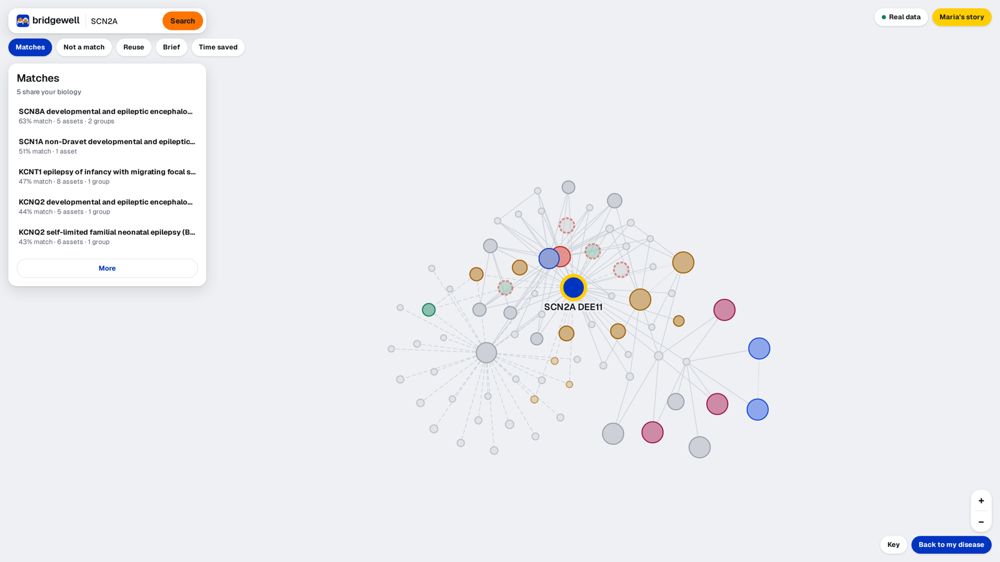
</p>

---

## What is Bridgewell

Bridgewell is a map of rare disease collaboration. Maria leads a patient organisation for SCN2A
DEE11, a rare epilepsy with no approved treatment. She types her disease into one search box and
Bridgewell answers three questions, with sources attached to every answer:

| Maria's question | What Bridgewell shows her |
|---|---|
| **Who shares our disease characteristics?** | Matches ranked by shared mechanism, with a score she can take apart, **and** the look-alikes that are explicitly *not* matches |
| **What useful work already exists?** | Registries, natural history studies and animal models she could reuse, each with a verdict: reusable as is, needs adaptation, or not applicable |
| **What should we do together next?** | A cited collaboration brief, a draft introduction email, and a timeline comparing starting from zero with joining a partner |

## The problem

There are more than 10,000 rare diseases, and most have no approved treatment. The families and
researchers behind each one usually work alone, so the same registries, studies and models get
built again and again.

- **Communities cannot find each other.** Two diseases with different names can share the same
  broken biology and could share a study. Nothing connects them.
- **Searching by name is actively misleading.** The same gene can cause two diseases that need
  *opposite* treatments: sodium channel blockers help SCN2A gain of function and can worsen Dravet
  syndrome. A name search puts them side by side.
- **Claims come without proof.** A patient group leader has to convince a board, a clinician or a
  funder. A suggested partner without a source is worthless to her.
- **Time is the scarcest resource.** Building a natural history study from scratch takes years.
  Joining one that already exists can take months.

## How Bridgewell answers it

1. **Mechanism beats gene name.** Neighbours are decided by shared mechanism and physiological
   direction, not by disease names. SCN8A DEE13 is Maria's top match at 63%: a different gene with
   the same sodium channel gain of function.
2. **Counterexamples are a feature.** Look-alikes with opposite biology get their own red
   "Not a match" cards, each with PubMed sources, and can never share a cluster or a route.
3. **Nothing without a source.** Every edge is labelled `curated`, `extracted` (with the verbatim
   quote) or `inferred`. Every generated sentence cites the edges behind it, and a citation that
   does not resolve is removed.
4. **Honest about "nothing found".** When there is no supported route, Bridgewell says so and
   shows what was searched, what is missing, and what to test next.
5. **Honest about 10×.** Joining one partner is 2.8× faster than starting from zero. Getting near
   10× takes a standing multi-disease platform, and the app names the assumptions that would have to hold.

## Built for Hack-Nation

Bridgewell was built for **Hack-Nation's 7th Global AI Hackathon**, on
**Challenge 5: "Buffalo Initiative x OpenAI: AI Atlas for the World's Rare Diseases"**.

The challenge asked for an AI atlas that maps rare diseases to the people, studies and assets that
could move them forward, using OpenAI models to **extract**, **reconcile** and **explain**.
Bridgewell implements all three as separate modules with versioned prompts and an audit log. The
models only ever see facts that already carry a source, and anything they write is labelled with
the model and prompt version. Without a key, every feature still works from deterministic templates.

## Screenshots

<table>
  <tr>
    <td width="50%">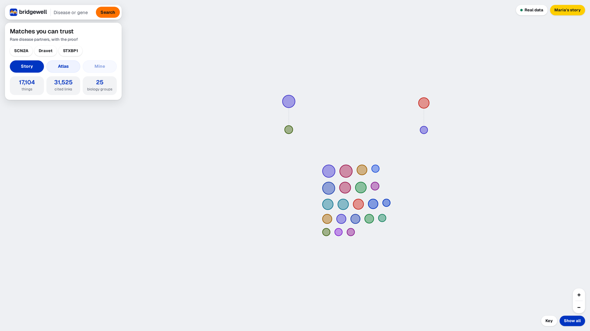</td>
    <td width="50%">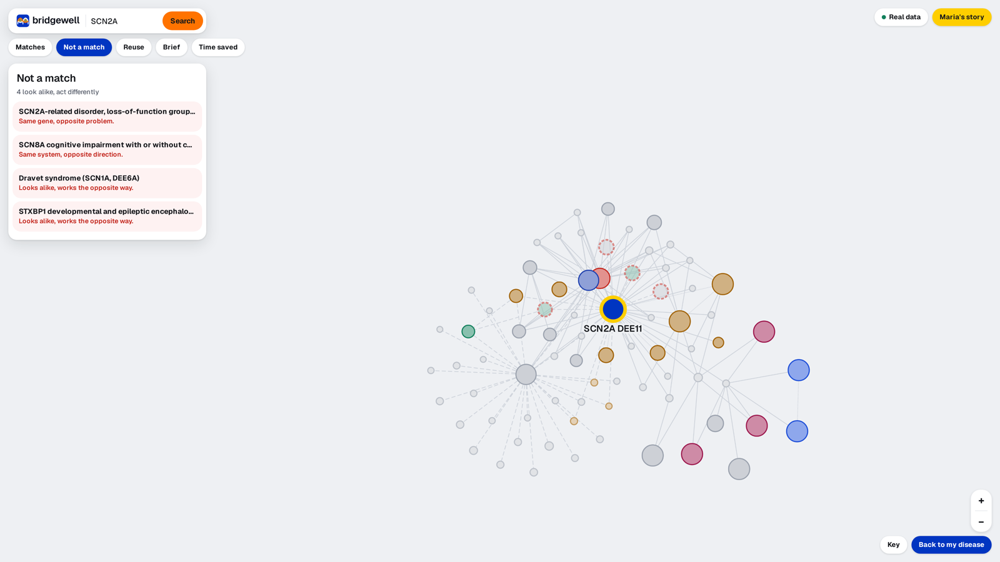</td>
  </tr>
  <tr>
    <td><b>The atlas.</b> 17,104 things, 31,525 cited links, 25 biology groups.</td>
    <td><b>Not a match.</b> Same gene, opposite problem. Look-alikes that would mislead a name search.</td>
  </tr>
  <tr>
    <td>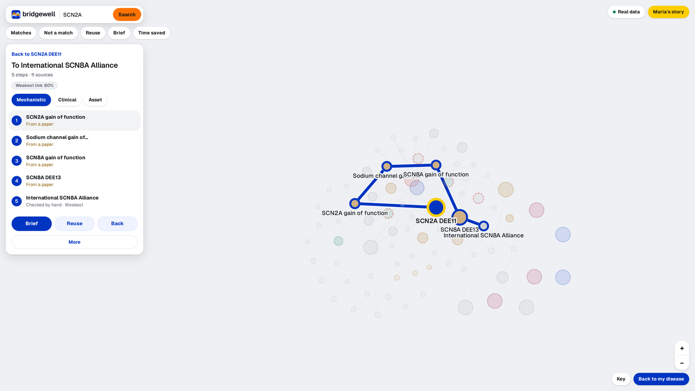</td>
    <td>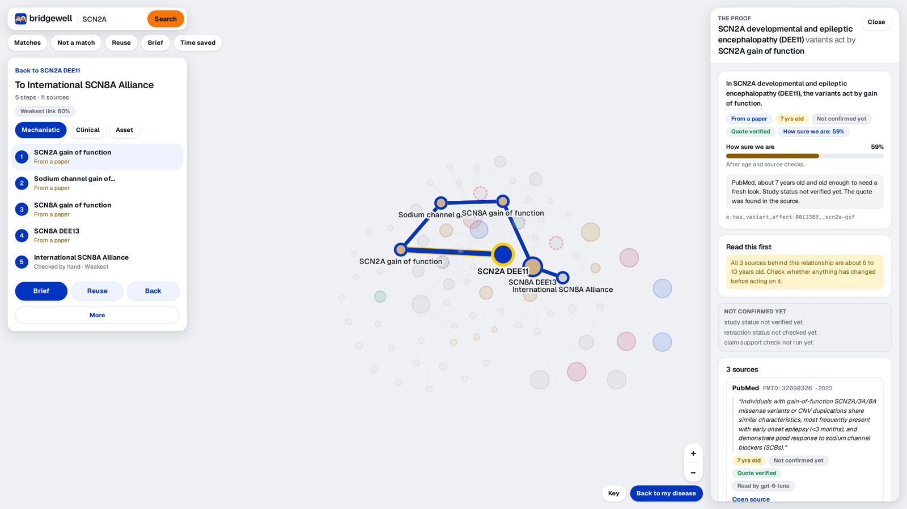</td>
  </tr>
  <tr>
    <td><b>Directions.</b> Five steps and eleven sources to the International SCN8A Alliance, weakest link named.</td>
    <td><b>The proof.</b> The verbatim PubMed quote, its age, its verification status and who read it.</td>
  </tr>
  <tr>
    <td>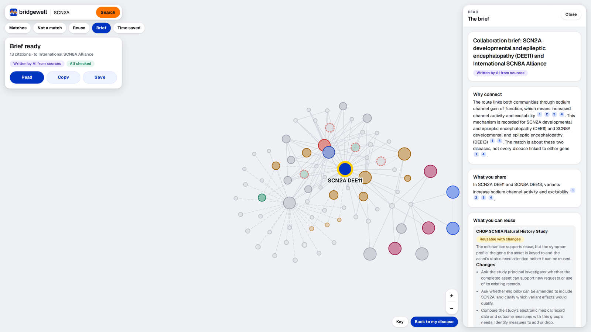</td>
    <td>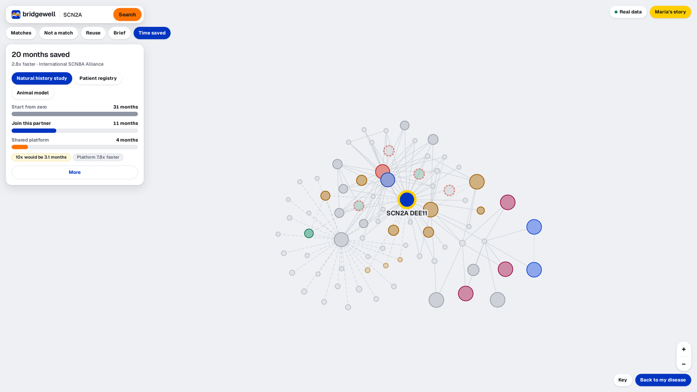</td>
  </tr>
  <tr>
    <td><b>The brief.</b> Why connect, what you share, what you can reuse, cited sentence by sentence.</td>
    <td><b>Time saved.</b> 31 months from zero, 11 by joining a partner, 4 on a shared platform.</td>
  </tr>
</table>

<details>
<summary><b>More screenshots</b></summary>
<br>
<table>
  <tr>
    <td width="50%">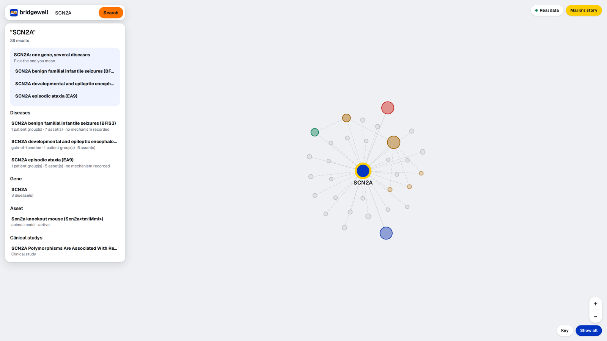</td>
    <td width="50%">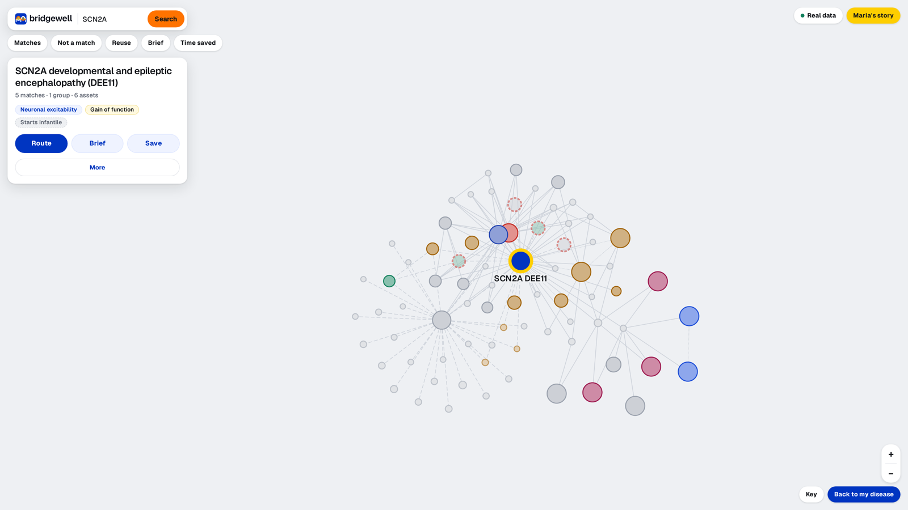</td>
  </tr>
  <tr>
    <td><b>Search.</b> One gene, several diseases: pick the one you mean.</td>
    <td><b>The place card.</b> Mechanism, effect and onset at a glance.</td>
  </tr>
  <tr>
    <td>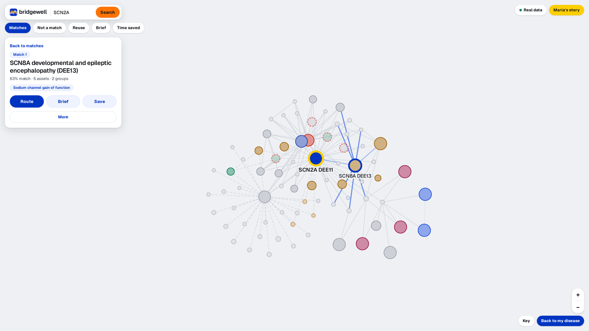</td>
    <td>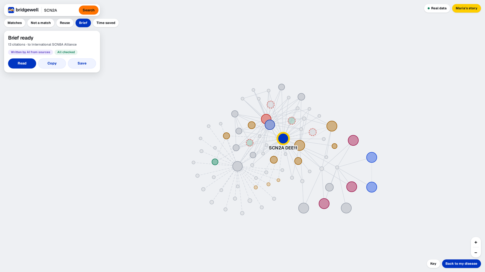</td>
  </tr>
  <tr>
    <td><b>A match up close.</b> The shared mechanism, drawn on the map.</td>
    <td><b>Brief ready.</b> 13 citations, written by AI from sources, all checked.</td>
  </tr>
</table>
</details>

## Repositories

| Repository | Description | Tech stack |
|---|---|---|
| [**bridgewell-web**](https://github.com/bridgewell-app/bridgewell-web) | The map-first frontend. One full screen map for the whole session, floating cards for matches, look-alikes, reuse, the brief and time saved, a proof drawer, and Maria's guided story. Live at [bridgewell-web.pages.dev](https://bridgewell-web.pages.dev). | TypeScript, React 18, Vite 6, Tailwind CSS v4, Cytoscape.js (fcose), TanStack Query 5, React Router 6, react-markdown, Playwright, Cloudflare Pages |
| [**bridgewell-api**](https://github.com/bridgewell-app/bridgewell-api) | The evidence graph and reasoning API. Builds a 17,104 node graph, scores matches and counterexamples, finds evidence routes, judges asset reuse, writes cited briefs and timelines, and audits every quote against its source. | Python 3.11, FastAPI, Uvicorn, Pydantic v2, NetworkX (Louvain, k-shortest paths), RapidFuzz, httpx, OpenAI SDK (OpenAI-compatible, gpt-oss:20b, gpt-6-luna), pytest, ruff, uv, Docker, CapRover, Vercel |
| [**bridgewell-data**](https://github.com/bridgewell-app/bridgewell-data) | The collected and curated dataset. Raw pages and API responses from biomedical sources, reviewed tables where every row quotes its source verbatim, and the scripts that fetch, check and rebuild them. | Python 3, Bash, Firecrawl CLI, NCBI E-utilities (PubMed), ClinicalTrials.gov API v2, NIH RePORTER API, MONDO, OMIM, Orphanet, HPO, HGNC, ClinVar, ClinGen, GenCC, MGI |
| [**.github**](https://github.com/bridgewell-app/.github) | This organisation profile: the overview, screenshots and brand assets. | Markdown, SVG |

## How it fits together

```
  public sources                 bridgewell-data               bridgewell-api                     bridgewell-web
  ──────────────                 ───────────────               ──────────────                     ──────────────
  MONDO · OMIM · Orphanet        raw pages + API records       import ─> merge ─> reconcile       one Cytoscape map
  HPO · HGNC · ClinGen · GenCC ─>  curated tables with      ─> ─> enrich ─> validate          ─>  matches · not a match
  PubMed · ClinicalTrials.gov      verbatim source quotes      evidence graph (NetworkX)          reuse · brief · time saved
  NIH RePORTER · NORD · MGI        quote check on import       matching · routing · clusters      proof drawer
                                                               Extract · Reconcile · Explain      Maria's story
                                                               FastAPI {ok, data, meta}
```

## Try it

| | |
|---|---|
| Live app | <https://bridgewell-web.pages.dev> (press **Maria's story** for the guided tour) |
| Live API | <https://bridgewell-api.faizath.com/docs> |
| Run locally | `make install && make dev` in bridgewell-api, then `npm install && npm run dev` in bridgewell-web |

## Brand

The logo is two half turns of a DNA double helix laid out as a two span bridge: the strands are
the arches and the deck, the base pairs are the hangers, and the strands cross over on the piers.

<p>
  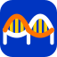
</p>

| Bridge blue | Strand orange | Base pair yellow | Ink |
|---|---|---|---|
| `#0035C1` | `#FF7300` | `#FECE00` | `#0B0F19` |

---

<p align="center">
  Built for Hack-Nation's 7th Global AI Hackathon · Challenge 5: Buffalo Initiative x OpenAI, AI Atlas for the World's Rare Diseases<br>
  <sub>Nothing in Bridgewell is medical advice. Every match is a hypothesis with its sources attached.</sub>
</p>
