


# 🧬 Bridgewell

**Matches you can trust.**

A map of rare disease collaboration that finds the communities sharing your biology and shows the proof behind every link.

---

## 🎬 Demo

  <a href="https://drive.google.com/file/d/162n-b2BUXvLOmyCJf8jYGj6b-bZ8Mwdb/preview">
    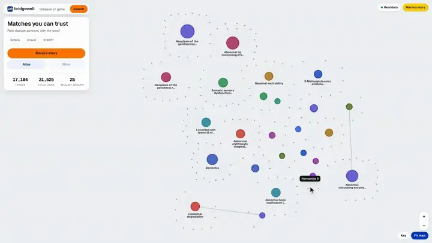
  </a>
   
  ▶ Click to watch the full demo on Google Drive

---

## 🔍 What is Bridgewell?

Bridgewell is a map of rare disease collaboration for patient organisation leaders, clinicians and
researchers. Maria leads a group for SCN2A DEE11, a rare epilepsy with no approved treatment. She
types her gene into one search box and gets three answers, each with sources: which communities share
the same broken biology, which look-alikes are *not* matches, and what existing registries, studies
and animal models she could reuse instead of building from zero.

Underneath, 17,104 diseases, genes, studies, groups and papers sit in one graph with 31,525 cited
links. Matches are scored by shared mechanism, pathway and rarity-weighted symptoms, never by disease
name. Every link is labelled curated, extracted (with the verbatim quote) or inferred, and clicking it
on the map opens its proof. Routes to a partner, a cited collaboration brief and a time-saved estimate
come out the other end, and every generated sentence cites the links behind it.

### 🎯 Built for

Bridgewell was built for **[Hack-Nation's 7th Global AI Hackathon](https://luma.com/z3za7zow)**, under the *Challenge 5: Buffalo Initiative x OpenAI: AI Atlas for the World's Rare Diseases* track.

---

## ❓ Problem → 💡 Solution

| ❓ Problem | 💡 How Bridgewell solves it |
|---|---|
| **Communities cannot find each other** — two diseases with different names can share the same broken biology and could share a study, but nothing connects them. | **Mechanism beats gene name** — neighbours are scored on shared mechanism and its direction, so SCN8A DEE13 is SCN2A DEE11's top match at 63% through the same sodium channel gain of function. |
| **Searching by name misleads** — the same gene can cause diseases that need opposite treatments, and a name search puts them side by side. | **Counterexamples are a feature** — look-alikes with opposite biology get red "Not a match" cards with PubMed sources and can never share a cluster or a route. |
| **Claims come without proof** — a suggested partner without a source cannot convince a board, a clinician or a funder. | **Nothing without a source** — every link is curated, extracted with its quote, or marked inferred; generated sentences cite their links, and a citation that does not resolve is removed. |
| **Time is the scarcest resource** — a natural history study built from scratch takes years. | **Reuse verdicts and a timeline** — each registry, study or model gets a reuse verdict, and the brief compares 31 months from zero with 11 by joining a partner. |
| **"Nothing found" usually means silence** — a tool that cannot connect two diseases either guesses or says nothing. | **Honest dead ends** — with no supported route, Bridgewell says so and shows what was searched, what is missing and what to test next. |

---

## 📸 Screenshots

<table>
<tr>
<td width="33%" align="center"><b>The atlas</b>  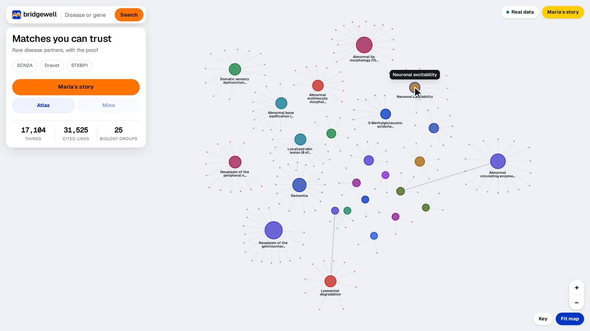</td>
<td width="33%" align="center"><b>One gene, several diseases</b>  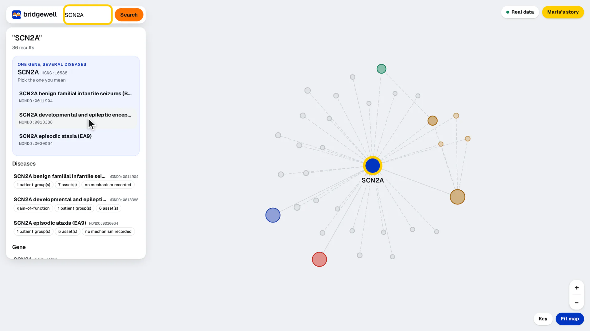</td>
<td width="33%" align="center"><b>Matches by mechanism</b>  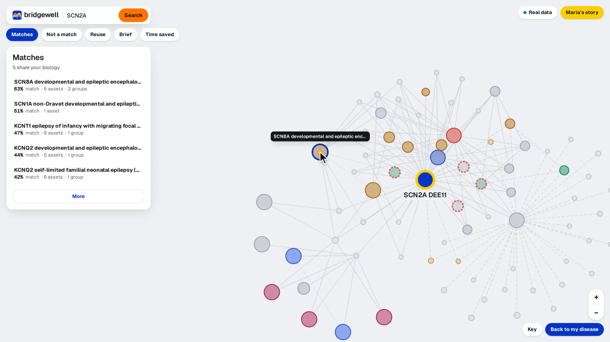</td>
</tr>
<tr>
<td width="33%" align="center"><b>Not a match</b>  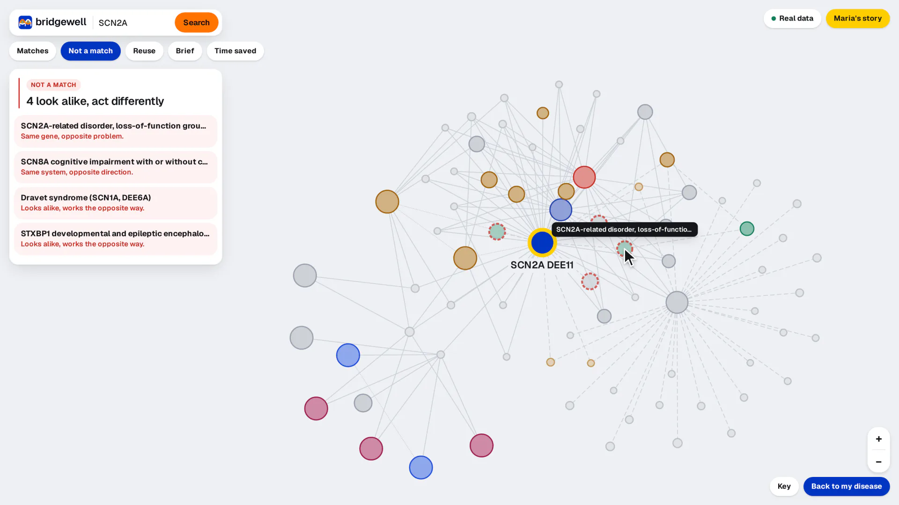</td>
<td width="33%" align="center"><b>Clicked on the map</b>  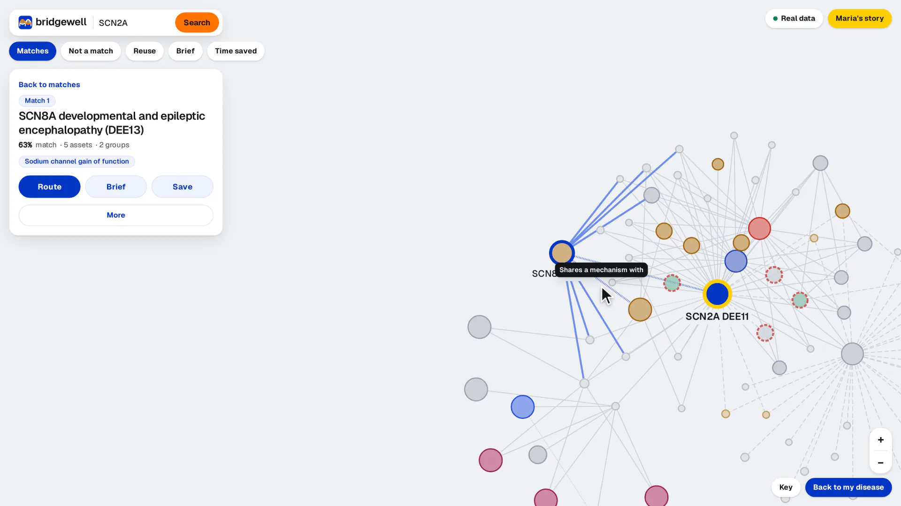</td>
<td width="33%" align="center"><b>The route</b>  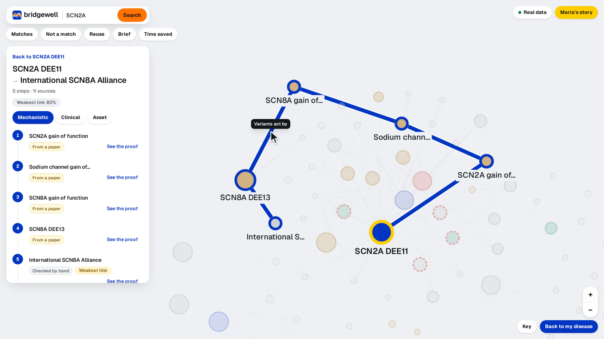</td>
</tr>
<tr>
<td width="33%" align="center"><b>The proof</b>  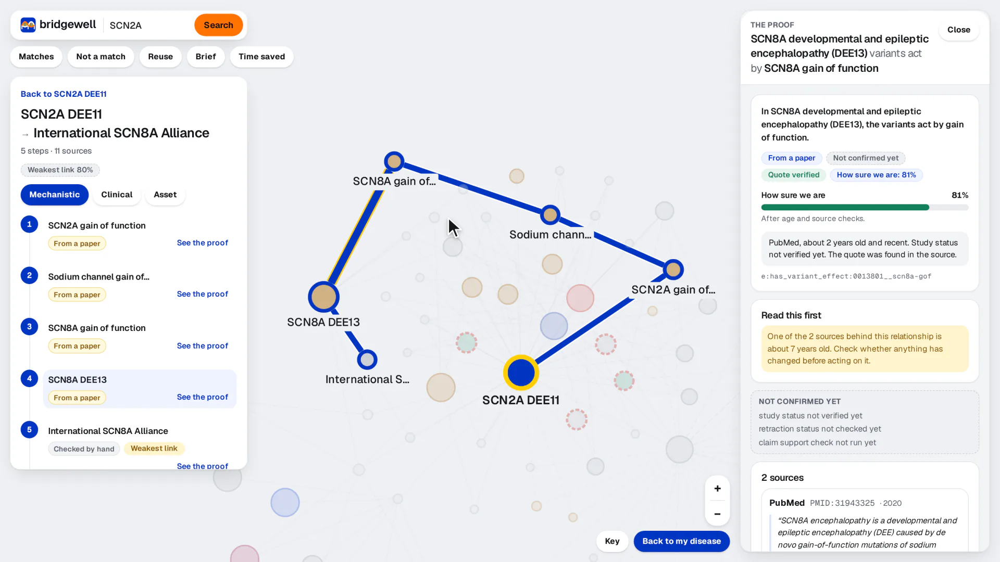</td>
<td width="33%" align="center"><b>The brief</b>  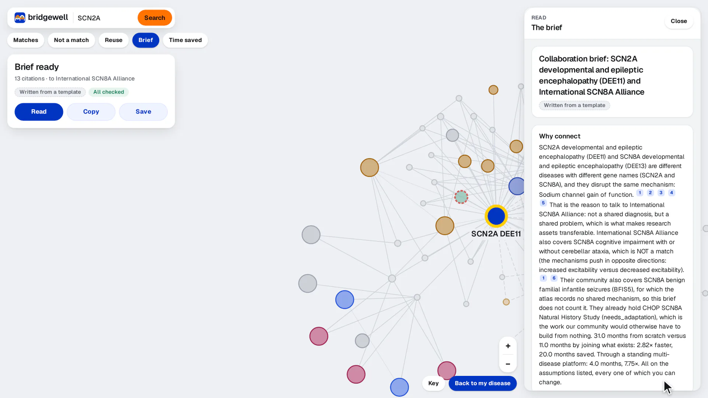</td>
<td width="33%" align="center"><b>Time saved</b>  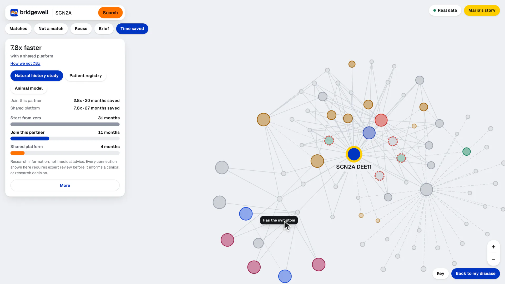</td>
</tr>
</table>

---

## 📦 Repositories

| Repository | Description | Tech Stack | Deployment |
|---|---|---|---|
| [**bridgewell-web**](https://github.com/bridgewell-app/bridgewell-web) | The map-first frontend: one full-screen graph, floating cards for matches, look-alikes, reuse, the brief and time saved, and a proof drawer. | TypeScript · React · Vite · Tailwind CSS · Cytoscape.js | [bridgewell.faizath.com](https://bridgewell.faizath.com) |
| [**bridgewell-api**](https://github.com/bridgewell-app/bridgewell-api) | The evidence graph and reasoning API: match scoring, counterexamples, evidence routes, reuse verdicts, cited briefs and timelines. | Python · FastAPI · Pydantic · NetworkX · OpenAI SDK | [bridgewell-api.faizath.com](https://bridgewell-api.faizath.com/docs) |
| [**bridgewell-data**](https://github.com/bridgewell-app/bridgewell-data) | The collected and curated dataset, where every reviewed row quotes its source, plus the scripts that fetch and rebuild it. | Python · Bash · Firecrawl · PubMed · ClinicalTrials.gov | — |
| [**.github**](https://github.com/bridgewell-app/.github) | This organization profile and its assets. | Markdown | — |

---

© 2026 Bridgewell Team

